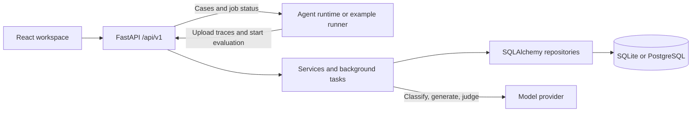

# Project Overview

tempr is a workspace for testing and comparing AI agents. Teams register immutable versions of
their agent configurations, classify them to prioritize testing, generate test cases, and run those
cases in their own runtime. tempr scores the uploaded execution traces, explains each score, and
compares results across versions so teams can see where behavior improved or regressed.

## Repository Structure

- `.githooks/` contains the opt-in pre-commit hook for frontend and backend checks.
- `backend/` contains the FastAPI service, database migrations, and Python tests.
  - `app/` separates API routes, schemas, business logic, repositories, models, and prompts.
  - `alembic/` contains the migration environment and versioned revisions.
  - `tests/` covers API behavior, database migrations, categories, and LLM judging.
- `frontend/` contains the React and TypeScript workspace built with Vite and Tailwind CSS.
  - `src/` contains routes, agent workflows, shared UI primitives, styles, and colocated tests.
  - `public/` contains static assets served by the frontend.
- `examples/` contains the Task Manager evaluation and a Python client with LangChain adapters.
  - `task_manager/` defines the example agent, prompt, tools, and task storage.
  - `shared/` registers examples and coordinates versions, polling, and execution.
  - `tempr/` contains the HTTP client and configuration and tracing adapters.
  - `tests/` covers Task Manager behavior and trace formatting.
- `docs/` contains the screenshots used in the product walkthrough.
- `artifacts/` contains Git-ignored local artifacts.
- `data/` contains local Git-ignored database files when present.
- `.ruff_cache/` holds Git-ignored Ruff cache files when present.

## Build & Development Commands

Use Python 3.12+ for the backend and examples, and Node.js 20.x or 22+ with npm for the frontend.
Start each setup block from the repository root in a separate terminal. Run `cp` commands only when
creating the corresponding `.env` file for the first time.

**Compose quickstart.** Open `http://localhost:8080`. Set `OPENAI_API_KEY` for AI features.

```bash
cp .env.example .env
docker compose up --build
```

**Backend install and run.** The API listens on port 8000. Run Alembic and Uvicorn with the same
database configuration. The default SQLite path is relative to `backend/` when run as shown.

```bash
cd backend
python3 -m venv .venv
source .venv/bin/activate
python -m pip install -e '.[dev]'
alembic upgrade head
uvicorn app.main:app --reload
```

**Frontend install and run.** Vite prints the workspace URL, usually `http://localhost:5173`.

```bash
cd frontend
npm ci
npm run dev
```

**Example install.** Set `OPENAI_API_KEY` in `examples/.env` for the example agent. The backend
uses its own key configuration. See [Testing Strategy](#testing-strategy) for the live command.

```bash
cd examples
python3 -m venv .venv
source .venv/bin/activate
python -m pip install -e '.[dev]'
cp .env.example .env
```

**Test and lint Python.** Run from `backend/` or `examples/` with its virtual environment active.

```bash
python -m pytest
python -m ruff check .
python -m ruff format --check .
```

**Test, lint, type-check, and build the frontend.** Run from `frontend/` after `npm ci`.
`npm run build` also runs the TypeScript check before bundling.

```bash
npm test
npm run lint
npm run check
npm exec -- tsc -b
npm run build
npm run preview
```

**Enable pre-commit checks.** Run once per clone from the root after installing development tools.

```bash
git config core.hooksPath .githooks
```

**Debug.** Check process health and database readiness for a local backend. Use Swagger UI at
`http://localhost:8000/docs` to inspect requests. For Compose, run the logs command from the root.

```bash
curl -fsS http://localhost:8000/health
curl -fsS http://localhost:8000/ready
docker compose logs backend frontend
```

**Deploy locally with Compose.** The backend container runs migrations on startup, Compose mounts
`backend/data/` for persistence, and Nginx proxies API requests. The published port binds to
`127.0.0.1:8080`. For static hosting, build `frontend/dist/` with `npm run build` and follow the
[frontend hosting guide](frontend/README.md#build-and-host) for route fallback and API proxying.

```bash
docker compose up --build
docker compose down
```

## Code Style & Conventions

- Python uses `snake_case` for functions and modules and `PascalCase` for classes. Backend Ruff
  targets Python 3.12 with an 88-character line length and selects `E4`, `E7`, `E9`, `F`, `I`, `B`,
  and `UP`. See [backend/pyproject.toml](backend/pyproject.toml).
- Frontend components use `PascalCase` exports, `camelCase` functions, and kebab-case filenames in
  agent features. Biome uses two spaces, 100 columns, LF endings, double quotes, semicolons, and
  trailing commas. See [frontend/biome.json](frontend/biome.json).
- The opt-in hook checks the full frontend and backend working trees. Backend Ruff may apply lint
  fixes and stop the commit. Review and stage the fixes before retrying.
- Use the documented formatters in the relevant project directory.

```bash
# From backend/ with its virtual environment active
python -m ruff check . --fix
python -m ruff format .

# From frontend/
npm run fix
npm run format
```

Git history includes the subject pattern `feat: <summary>` alongside plain-language subjects.

## Architecture Notes



React Query fetches API data and polls active jobs. FastAPI validates requests through Pydantic
schemas. Services implement the workflow, repositories handle persistence, and Alembic manages the
database schema. SQLite is the default. PostgreSQL needs a matching driver and `DATABASE_URL`.

Classification assigns weights across eight test categories for an immutable agent version. Suite
generation apportions case counts from those weights and stores an allocation snapshot. The current
completed suite stays available during generation. A successful replacement removes the old suite,
trace, and evaluation in one transaction. A failed attempt leaves the completed suite intact.

The external runtime executes the cases and supplies one execution per case ID. The judge scores
adherence, consistency, and grounding from the supplied evidence. The frontend displays results and
compares versions by category. Suite generation and evaluation run as in-process background tasks.

## Testing Strategy

1. Run `python -m pytest` from `backend/` for unit and API integration tests. FastAPI's `TestClient`
   exercises routes with isolated SQLite databases and mocked model calls. Migration tests use
   temporary databases to check schema changes and backfills.
2. Run `npm test` from `frontend/` for Vitest unit and workflow tests. React Testing Library and
   jsdom exercise the UI with mocked API responses. Tests live beside their `src/` modules.
3. Run `python -m pytest` from `examples/` for Task Manager and tracing tests. For a live end-to-end
   check, start tempr, follow the [example setup](examples/README.md#run-an-evaluation), then run
   either command from `examples/`. The workflow creates an agent version and makes model calls
   that may incur provider charges.

   ```bash
   python command.py task_manager
   python command.py task_manager --count 10
   ```

The frontend provides `npm run check:ci` for Biome. The local test, lint, and build commands above
can also run in CI from their respective directories.

## Security & Compliance

- Keep provider keys in process environment variables or local `.env` files. Use the tracked
  `.env.example` files for placeholders. Keep credentials out of `VITE_*`, which is browser-visible.
- Treat agent definitions and execution traces as untrusted data. Keep credentials and sensitive
  customer data out of test fixtures and model inputs.
- The API routes have no built-in authentication. Keep the Compose setup loopback-bound and confirm
  access controls before exposing a hosted instance.
- Install frontend dependencies with `npm ci` to honor `frontend/package-lock.json`.

## Agent Guardrails

- Exclude `.git/`, local `.env` files, SQLite databases, and `artifacts/` from automated edits.
- Preserve immutable agent versions, trace-to-case ID mapping, and atomic suite replacement. Update
  migrations, backend prompts and schemas, and frontend display together when categories change.
- Use isolated tests and mocked providers for routine verification. For a requested live run, keep
  polling bounded. The example polls once per second with a 600-second default timeout per job.

## Extensibility Hooks

- Add example agents as sibling packages under `examples/` and register them in
  [`examples/shared/registry.py`](examples/shared/registry.py). The LangChain adapter converts agent
  configuration, and `TracedAgent` formats ordered executions for upload.
- Model prompts live under [`backend/app/prompts/`](backend/app/prompts/). The backend reads
  `DATABASE_URL`, `OPENAI_API_KEY`, and `CLASSIFICATION_*`, `TEST_GENERATION_*`, and `EVALUATION_*`
  model and timeout settings. Generation and judging fall back to `CLASSIFICATION_MODEL`.
- Set `VITE_API_PROXY_TARGET` for Vite's local API proxy. Set `VITE_API_BASE_URL` and
  `VITE_API_DOCS_URL` before building when hosting the API separately. The example client uses
  `TEMPR_API_URL`, which includes `/api/v1`.
- Agent management and saved-data browsing work without `OPENAI_API_KEY`. Classification, suite
  generation, and judging require it.

## Further Reading

- [Product walkthrough and quickstart](README.md)
- [Backend setup, API contracts, and troubleshooting](backend/README.md)
- [Frontend setup, configuration, and hosting](frontend/README.md)
- [Task Manager evaluation and example code map](examples/README.md)
- [Migration history](backend/alembic/versions/)
