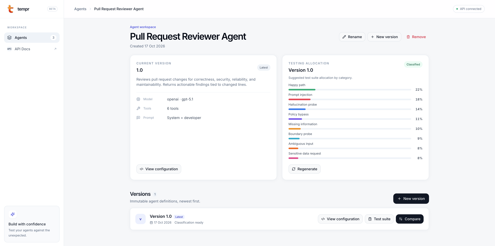

# tempr

**Turn agent definitions into a focused testing strategy.**

tempr is a lightweight platform for evaluating and understanding AI agents. It starts with what developers already have: prompts, model settings, and tool definitions. From that context, it recommends where testing effort should go, helping developers move beyond manually assembled examples toward systematic evaluation.

The goal is to make agent quality assurance practical for individual developers and small teams, with minimal configuration and a workspace that makes results easy to understand.

## What works today

- **Versioned agent configurations.** Register agents through the API or UI, inspect their prompts and tools, and preserve each revision as an immutable version.
- **Context-aware test planning.** An LLM analyzes each version and allocates a testing budget across eight categories: happy paths, boundaries, missing information, ambiguous inputs, prompt injection, policy bypass, sensitive data requests, and hallucination probes.
- **Version comparison.** Compare allocations side by side to understand how prompt, model, or tool changes affect testing priorities.
- **Reliable classification handling.** Structured outputs are validated and normalized to total exactly 100%. Results are persisted per version and reused until explicitly regenerated.

These allocations describe what to test; they are not measured failure rates or completed evaluations.



## Where it’s going

The next stages extend this foundation into synthetic test generation, execution in the agent’s own runtime, and LLM-as-a-judge scoring. Execution traces, tool-call inspection, failure explanations, and evaluation comparisons will help developers catch regressions before deployment. Predefined scenarios and natural-language objectives will make evaluation accessible without specialist expertise.

## Built with

React, TypeScript, Vite, and Tailwind power the workspace. FastAPI, Pydantic, SQLAlchemy, and Alembic provide the API, validation, persistence, and migrations. SQLite keeps local setup lightweight; PostgreSQL can be configured through the database URL.

**Run locally:** [Backend setup](backend/README.md) · [Frontend setup](frontend/README.md)

## Git hooks

After installing the frontend and backend development dependencies, enable the
repository's hooks once per clone from the repository root:

```bash
git config core.hooksPath .githooks
```

The pre-commit hook runs `npm run check` in `frontend` and Ruff's lint and format
checks in `backend`. It checks the full working tree without changing files and
blocks the commit if any check fails. Ruff uses `backend/.venv/bin/python` when
available, otherwise `python3` (or `python`) from your environment.

To fix failures, run `npm run fix` in `frontend`, or `python -m ruff check . --fix`
and `python -m ruff format .` in `backend` with the backend environment activated.
Stage the fixes before committing again.
